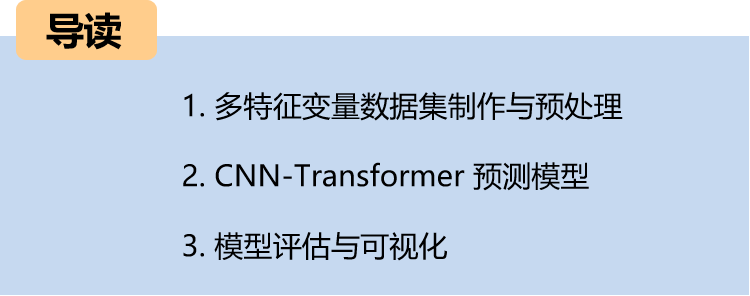
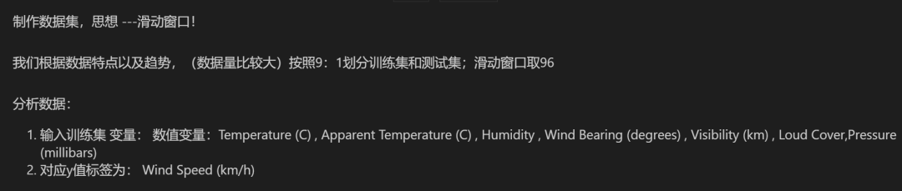
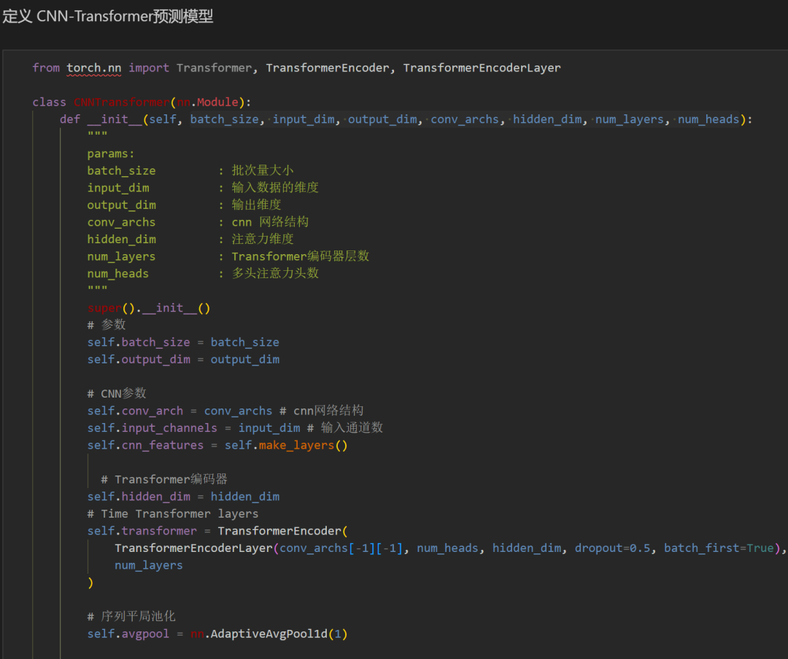
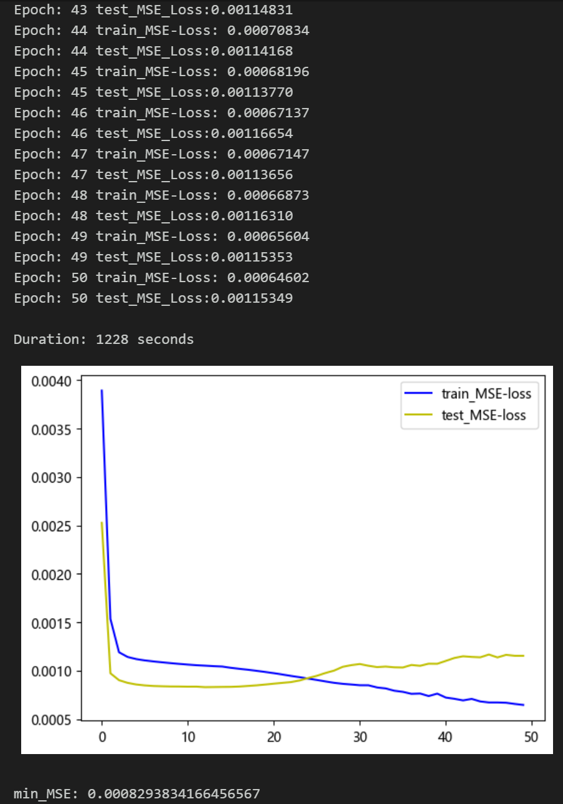
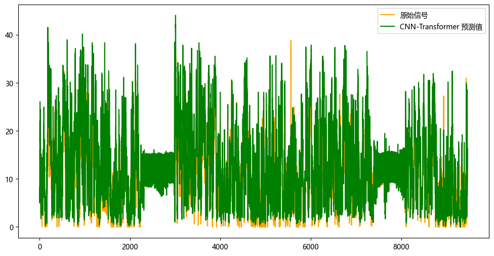
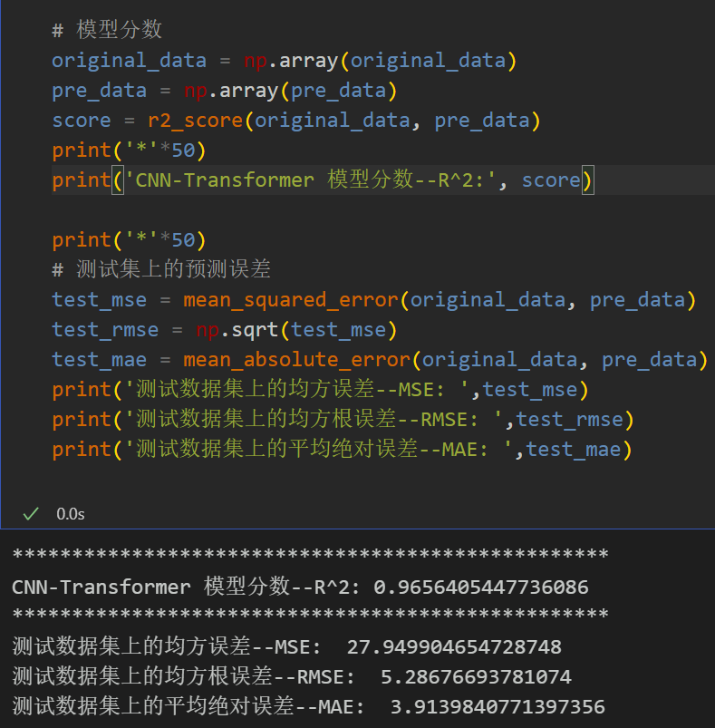
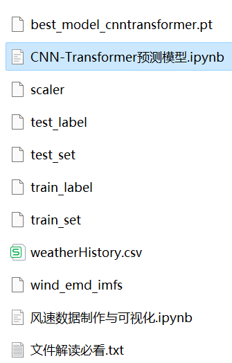

# Multi-feature Variable Sequence Prediction (III) CNN-Transformer Wind Speed Prediction Model

Single-variable includes the following content:
1. Includes wind speed data, as well as pre-generated wind speed dataset and label set, all of which can be run.
2. CNN-Transformer model, with smaller MSE and MAE, especially noticeable effect.
3. Includes code for data preprocessing, and complete CNN-Transformer model prediction code and visualization code.
Environment: Python 3.9
Preface
This article is based on the previously introduced wind speed data (attached at the end of this document), introducing a multi-feature variable sequence prediction model CNN-Transformer to improve the predictive performance of time series data. The dataset consists of nine variables including weather, temperature, humidity, pressure, and wind speed, and it is created by creating datasets using sliding windows. Multi-variables are used to predict wind speed.
LSTF (Long Sequence Time-Series Forecasting) problem refers to the need to handle long sequences in time series forecasting. In practical applications, time series may contain a very large number of data points. In such cases, traditional time series forecasting models may encounter some challenges because they may encounter issues when processing long sequences, such as:
Long-term dependency: As the time series data grows, the model needs to be able to capture long-term dependencies and trends.
Computational complexity: Training and predicting for long sequences usually requires more computational resources and time.
Memory consumption: Long sequences often require a large amount of memory to store data and model parameters, which may lead to memory exhaustion or performance issues.
In processing LSTF issues, selecting the appropriate window size (window size) is crucial. Selecting the right window size can help the model better capture patterns and features in time series. To extract longer dependencies in sequences, this paper increases the window size to 96 and employs a CNN-Transformer model to fully extract feature information from the sequence.
1 Data Preparation and Preprocessing for Multi-Feature Variables
\t1.1 Import Data
\t1.2 Data Preparation and Preprocessing
\tFirstly, divide the dataset into training and testing sets at a ratio of 9:1.
\t  
\t\tData Preparation
2 CNN-Transformer Prediction Model Based on Pytorch
\t2.1 Define the CNN-Transformer Prediction Model
\tNote: The shape of wind speed data is [256, 96, 8], batch_size=256, where 96 represents the sequence length (the sliding window takes values), and the dimension of 8 represents the selected 8 variables.
\t  
\t2.2 Set Up Parameters and Train the Model
\t50 epochs, MSE is 0.0008293, indicating that the multi-variable feature CNN-Transformer prediction model performs well. Further adjustments to the model parameters can further improve the model's predictive performance.
\tNote: Adjust parameters as needed:
\tIncrease the number of CNN layers and hidden layer dimensions, adjust learning rate;
\tAdjust the number of Transformer encoder layers and dimensions, increase more epochs (be cautious not to overfit);
\tChange the sliding window length (set an appropriate window length)
3 Model Evaluation and Visualization
\t3.1 Results Visualization
\t3.2 Model Evaluation

## Images

<!-- PAYMENT_BLOCK -->

## Get this dataset

- Payment link (Stripe): [Buy now](https://buy.stripe.com/3cs8yP7sY87d0vu9AB)
- Payment QR code: 

<!-- /PAYMENT_BLOCK -->
